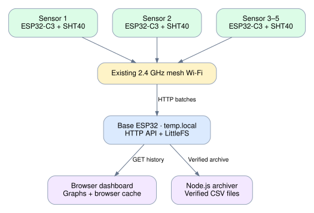
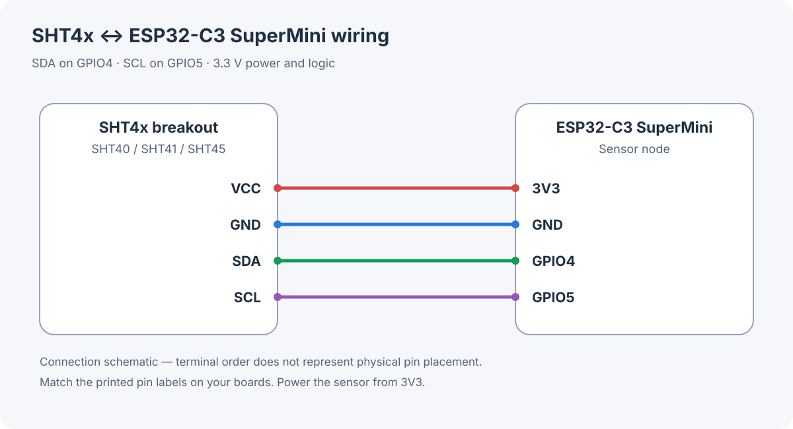
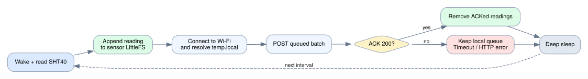

# ESP32 Wi-Fi temperature and humidity monitoring

Battery-powered **ESP32-C3 SuperMini + SHT40** nodes log temperature and humidity, buffer unsent readings in LittleFS, and upload batches over an existing **2.4 GHz Wi-Fi network** to an always-powered ESP32 base. The base serves its dashboard and HTTP API at **http://temp.local/**. Communication uses **Wi-Fi and HTTP, not ESP-NOW**.

This repository is the maintained project. It includes the sensor and base firmware, the live dashboard, and a Node.js app for weekly CSV archives and historical viewing.



## Repository layout

| Path | Purpose |
|---|---|
| `config.h.example` | Shared configuration template; copy to local `config.h` |
| `sensor_node/sensor_node.ino` | SHT40 sampling, flash queue, Wi-Fi uploads and deep sleep |
| `base_station/base_station.ino` | HTTP API, NTP time, mDNS and LittleFS history |
| `dashboard.html` | Editable live dashboard source |
| `base_station/dashboard_page.h` | Generated dashboard embedded in the base firmware |
| `archive-app/` | Weekly archiver and local archive viewer; Node.js 22+, no npm packages |
| `docs/` | Architecture, sensor lifecycle and wiring diagrams |
| `scripts/embed_dashboard.py` | Regenerates the embedded dashboard |
| `tests/` | Dashboard, archive and firmware host tests |
| [HISTORY_FETCHING.md](HISTORY_FETCHING.md) | Fetching implementation, migration and hardware verification |

`config.h` contains local Wi-Fi settings and is excluded from future commits. Use the example when setting up another checkout. Ignoring the file does not remove earlier committed copies from Git history.

## Setup

1. Copy `config.h.example` to `config.h` if you do not already have local settings. Set `WIFI_SSID`, `WIFI_PASSWORD`, `SAMPLE_SECONDS` and optionally `BASE_FALLBACK_IP`. The default base hostname is `temp`, port 80, and sampling interval 120 seconds.
2. Set a unique `DEVICE_ID` from 1–255 in `sensor_node/sensor_node.ino` for each sensor. This checkout currently specifies **3**. Install Adafruit SHT4x and its dependencies, and select the appropriate ESP32-C3 board and LittleFS-capable partition scheme.
3. Wire the sensor as shown below. Compile and flash each sensor with its own ID.
4. Compile and flash `base_station/base_station.ino` to the always-powered base. When updating an existing base, upload the application only and preserve its partition layout, LittleFS data and NVS. Provision a new filesystem deliberately; the base does not auto-format a mount failure.
5. Open **http://temp.local/** from a browser on the same LAN. Wi-Fi infrastructure must permit client communication and mDNS. The sensor uses `MDNS.queryHost()` and can use the configured fallback IPv4 address if name discovery fails.
6. The base obtains time through NTP. Sensors obtain time from the base when available and upload queued readings after reconnecting.

Both sketches include `../config.h`. Some Arduino build workflows copy sketches into temporary directories and cannot resolve parent-relative headers. Preserve the supplied layout, use a shared Arduino library, or provide matching local headers when adapting the build. Keep the configuration consistent between devices.

## Sensor wiring



The diagram shows electrical connections, not physical pin positions. Match the printed labels on your boards.

| SHT4x breakout | ESP32-C3 SuperMini |
|---|---|
| VCC | 3V3 |
| GND | GND |
| SDA | GPIO4 |
| SCL | GPIO5 |

Use 3.3 V power and logic. Most SHT4x breakouts include I²C pull-up resistors; check your module. Keep the sensor away from the ESP32 regulator and power LED to reduce temperature bias. The sketches use GPIO4/GPIO5; check your exact board before substituting boot-related pins.

## Sensor wake, buffer, upload and sleep



Each wake saves the new measurement locally before attempting the network. The sensor sends queued rows to `POST /api/readings`; a valid `200 ACK <sequence>` permits removal of acknowledged rows. Failed connections, timeouts and HTTP errors retain the queue for a later wake. The sensor sleeps for the remainder of the configured cycle.

LittleFS readings and NVS sequence counters can survive battery removal, but RTC time does not. Sequence-based timestamp backfill assumes regular sampling, so readings recovered after a battery replacement or offline gap may have approximate timestamps.

**Existing sensor behaviour:** the sensor attempts `LittleFS.begin(true)` if its initial mount fails. This recovery path can format a corrupted filesystem and erase unsent readings. The base does not use that fallback. The history/dashboard update leaves the sensor firmware unchanged.

## Live dashboard

The base serves the page and API at **http://temp.local/**. The dashboard displays latest sensor readings before historical backfill completes, fetches incrementally by record ID, updates progress per batch and polls every 30 seconds. Manual and automatic fetches share an overlap guard. Sensor cards use the same colours as their chart lines and legend.

The live view shows readings still retained on the base. Its IndexedDB cache is checked against the current dataset and retained-record boundary before display; archived readings disappear after the next successful refresh. If storage is unavailable, the page continues in visibly labelled memory-only mode. Old datasets remain separately stored when a base reset is detected; they are not mixed into the current live view.

Cards show measurement timestamps and age, with a configurable overdue threshold (default 360 seconds). They describe recent measurements, not continuously connected sleeping sensors. The existing log does not store receipt timestamps.

Download CSV makes a copy without deleting base readings. Use the Node app below for routine archiving. The browser also retains an optional folder-based archive flow, but direct folder writing requires a supported browser on localhost/HTTPS rather than ordinary `http://temp.local`. Mixed-content and private-network restrictions may require a same-origin HTTPS proxy. See [history fetching notes](HISTORY_FETCHING.md) for technical details.

## Weekly archiving and historical viewing

Requires **Node.js 22 or later**. Run from this repository root; no npm installation is required.

```sh
node archive-app/app.mjs archive
```

The app downloads a bounded snapshot, writes a dated CSV under `archive-app/archives/<dataset>/`, flushes and verifies it, then acknowledges the saved record IDs. The base removes only that archived prefix and retains newer uploads. Dataset identity, global record IDs and sensor deduplication counters remain intact. Uploads are not frozen by an archive lease; individual synchronous requests can still delay service.

To view saved history:

```sh
node archive-app/app.mjs serve
```

Open **http://127.0.0.1:8080**. The viewer reads saved CSV files and provides date ranges, sensor/dataset filters, temperature/humidity graphs and CSV export. The base can be offline while viewing archives. For current unarchived readings, use `http://temp.local`.

Use `--base` to select a different base address and `--dir` to choose an archive folder. Use the same archive directory for subsequent runs and viewing. No weekly schedule is installed automatically. Back up this directory: after acknowledgment, these files are the long-term copy.

If acknowledgment fails, retain the saved CSV and rerun the command. The viewer combines overlapping records by dataset and ID and rejects conflicting records. Read [the archive app instructions](archive-app/README.md) for examples, locking, retries and recovery.

This version uses dataset-checked `/api/archive/ack` (archive protocol 2). The separate folder's lease-based archiver and `/api/archive/start`, `/renew`, `/commit` workflow are not part of this version and must not be mixed with this firmware. Routine archiving never calls `/api/reset`.

## Base API

| Method | Path | Purpose |
|---|---|---|
| GET | `/` or `/dashboard.html` | Live dashboard |
| GET | `/api/meta` | Dataset, archive protocol, latest ID and retained-record boundary |
| GET | `/api/time` | NTP-backed Unix time; 503 until synchronized |
| POST | `/api/readings` | Sensor CSV batches; returns `ACK <sequence>` |
| GET | `/api/latest` | Cached latest retained reading per detected sensor |
| GET | `/api/history?after=ID` | Incremental history; up to 100 records per page, also byte-limited |
| POST | `/api/archive/ack?dataset=ID` | Remove the verified archived prefix; body is its highest record ID |
| POST | `/api/reset` | Explicit destructive reset; requires `RESET ALL READINGS` |

## Capacity, security and limitations

- Five sensors reporting every two minutes produce 3,600 readings/day. At an illustrative 35–45 CSV bytes per row, allow roughly 126–162 kB/day before filesystem overhead. Actual capacity depends on the selected partition layout, not just total flash size. Archive before the filesystem fills; compaction also needs room for a replacement log.
- HTTP endpoints are unauthenticated. Use a trusted private LAN and do not expose the base to the internet. A reset confirmation phrase or dataset identifier is not authentication.
- Log appends and Preferences/NVS updates are separate operations. Power-loss behaviour requires hardware testing; do not assume fully transactional storage.
- The base uses a synchronous HTTP server. Upload flushes, NVS writes, boot recovery and archive compaction can delay service. Indexed history reads reduce repeated scanning without loading the entire log into RAM.
- Browser storage belongs to one browser/profile and is not a substitute for CSV archives. The archive viewer loads files into memory; very large histories may take longer to load and draw.
- The updated firmware has not been compiled or tested on physical ESP32 hardware here. Confirm mDNS, upload retries, interrupted compaction, storage-full behaviour and battery replacement on your devices.

## Explicit reset

Use **Reset all readings…** on the live dashboard only when intentionally starting over. It removes base readings and compaction files, resets deduplication metadata and global IDs, changes the dataset identifier, and clears the active browser history through the confirmed reset flow. Downloaded CSV files are not deleted. Sensors are not erased and continue uploading.

Other browsers detect the new dataset on refresh and retain their previous dataset separately. If the base reset succeeds but browser cleanup fails, the next fetch selects the new dataset. Reset does not securely erase physical flash and is not a routine archive operation.

## Development and verification

After changing `dashboard.html`, regenerate the embedded page before flashing:

```sh
python3 scripts/embed_dashboard.py
node --test tests/archive.test.mjs tests/dashboard.test.cjs
python3 tests/firmware_index_test.py
git diff --check
```

The automated tests use simulated browser/storage and base services plus host C++ checks. They do not replace compilation for the target board or hardware/power-loss verification. See [the hardware verification checklist](HISTORY_FETCHING.md).

The complete base/dashboard/archive upgrade requires rebuilding and flashing the **base station only**, preserving its stored data. Existing Wi-Fi sensor nodes need no reflashing for these improvements.
